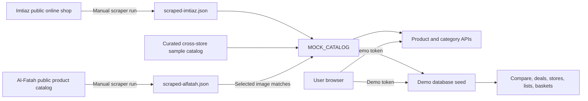

# Grocify Partner Guide

This guide explains how to try Grocify, what each part of the app does, and where its product and price information comes from. It covers the app as it works today, including the limits of its demo data.

## 0. The project at a glance

Grocify is a web app built with Next.js, React, TypeScript, and Tailwind CSS. The browser pages call the app's own `/api/...` routes for product search and demo actions. Those routes check the demo token, then read from bundled catalog files or the in-memory mock database. The site is deployed on Vercel; pushes to the connected GitHub `main` branch start a production deployment.

## 1. Open Grocify and sign in

Open the live demo at [grocify-hazel.vercel.app](https://grocify-hazel.vercel.app). On the sign-in page, choose **Sign in as Demo User (1-Click)**. The email and password shown on that page also work. The same demo credentials are documented in [`DEMO-CREDENTIALS.txt`](DEMO-CREDENTIALS.txt).

The demo does not create personal accounts. Sign-up and Google sign-in are disabled. Signing out clears the demo session from that browser; it does not create or delete a real account.

After sign-in, use the main menu to visit **Home**, **Categories**, **Compare**, **Smart Deals**, **My Baskets**, **Pantry Inventory**, **Stores**, and **My Lists**. On a phone, open the menu with the button at the top left. The sun/moon control changes the display theme.

## 2. Browse products

### Home

Use **Home** to browse the product catalog. Search by product name, brand, category, or subcategory, or choose a category from the filter. Product cards can show a product photo, product/brand name, pack size, listed price, supplier, and a discount when the source data includes one. Use **Add to List** on a card to save a product to a shopping list.

### Categories

Choose **Categories** to browse the retailer category tree. Select a category and then a subcategory to open its products. The category names come from the bundled Imtiaz category snapshot. Use **Back** or the breadcrumb to return to the category list.

### Compare & Save

Choose **Compare** to look up products that have multiple store offers in the catalog. Search, select a category, and sort by savings, low price, high price, or store count. Open a product card to see its offers and store links. The card's lowest listed price is the catalog's current `minPrice`; it is not a checkout quote. Use **Add to Basket** to save that catalog item to a basket.

## 3. Use deals and baskets

### Smart Deals

**Smart Deals** shows themed baskets such as weekly essentials and breakfast items, plus a savings list. The app selects products by subcategory from the catalog and totals their listed minimum and maximum prices. Use **Take this deal** to create a basket from the products in that deal.

### My Baskets

In **My Baskets**, create a custom basket or open one to review its items. You can add products, remove them, and replace an item with a suggested alternative when one is available. Basket totals and store choices are calculated from the catalog offers. Grocify does not place orders, take payment, or reserve products; store links take you to the retailer.

## 4. Keep lists and pantry inventory

### My Lists

Create a list with a name and optional description. Use **Add to List** from a product card to add a product, then open the list to review it. Lists show product information and an estimated total based on the saved catalog prices. You can edit or delete lists and remove items.

### Pantry Inventory

Use **Pantry Inventory** to record items already at home. Add a name, quantity, unit, category, low-stock threshold, expiry date, and optional notes or barcode. Adjust quantities as you use or restock items. Filters help find low-stock, expiring, or category-specific items. The low-stock indicator compares quantity with your threshold; the expiring indicator uses the expiry date entered for the item.

## 5. Browse stores and ask the assistant

### Stores

**Stores** lists the demo retailers alphabetically. Open a store to see its catalog offers and follow or unfollow it. Store cards also display follower counts. In this demo, store profiles and starting follower counts are sample data; following a store does not subscribe to retailer notifications.

### Grocify assistant

Open the chat button to ask about products, the app, recipes, or meal ideas. Product searches are matched against Grocify's local catalog. Common help questions can use the built-in FAQ. Recipe generation and broader AI responses use the configured Groq or OpenAI provider when an API key is available. Without a provider key, the assistant still supports catalog search and FAQ responses, but cannot generate full AI recipes.

The assistant can suggest matching catalog ingredients and an estimated grocery total. Recipe instructions are generated suggestions, and ingredient matches are best-effort catalog matches; review them before shopping. Chat messages are sent to the selected AI provider when AI generation is enabled. Optional LangSmith tracing is off by default; enabling it sends model-call prompts and responses to LangSmith.

## 6. Where the product and price data comes from

The current app is a demonstration built from bundled catalog snapshots and curated examples. It does not query retailer prices live each time someone opens a page.



### Imtiaz catalog snapshot

The main product snapshot is [`src/lib/scraped-imtiaz.json`](src/lib/scraped-imtiaz.json). The import script reads the public Imtiaz shop configuration, delivery cities and branches, then its public menu/catalog response. It records product names, images, prices, brand and pack-size information when available, source category names, and the selected branch/location. The default city is Karachi; a branch exposed by the shop is selected by default. The category tree is saved separately in [`src/lib/imtiaz-categories.json`](src/lib/imtiaz-categories.json).

This is a point-in-time snapshot. Prices and availability can change at the retailer after the file was created. The snapshot is refreshed only when someone runs the import command and commits/deploys the updated files.

### Curated cross-store examples

[`src/lib/mock-catalog.ts`](src/lib/mock-catalog.ts) combines the Imtiaz snapshot with a hand-curated catalog used to demonstrate cross-store comparison and deals. The curated entries include example offers, `storeCount`, minimum/maximum prices, and savings for stores such as Chase Up, Bin Hashim, Metro, and Carrefour. Those cross-store offer values are sample catalog data; they are not being fetched live from those retailers. Check the retailer's own listing before making a purchase.

Where an Imtiaz snapshot product has the same canonical ID as a curated entry, the snapshot entry is used. Curated entries that do not have a verified image show the app's fallback instead of an unrelated stock photo.

### Al-Fatah and Open Food Facts

The Al-Fatah scraper writes [`src/lib/scraped-alfatah.json`](src/lib/scraped-alfatah.json) from the public shop catalog. It checks the site's `robots.txt`, caps each run at 1,000 entries, and waits between page requests. **At present, these Al-Fatah products are not merged into the live product/offer catalog.** The runtime catalog uses selected Al-Fatah image matches for a small number of curated products; it does not currently use the file as a full second-store price feed.

The optional Open Food Facts script writes reviewed image matches to [`src/lib/openfoodfacts-images.json`](src/lib/openfoodfacts-images.json). The runtime catalog does not currently read that file, so those matches do not appear in the app yet. Open Food Facts images require attribution and share-alike reuse under the license recorded by the script.

### How app pages use that catalog

- **Home and category pages** call the products API, which maps `MOCK_CATALOG` into product-card fields and applies search, category, and pagination filters.
- **Compare** calls the catalog API. In the current demo setup, the database adapter is a local mock seeded from `MOCK_CATALOG`, so its catalog query resolves to that bundled data rather than a connected cloud Firestore database.
- **Smart Deals** selects eligible items from the seeded catalog (`storeCount` of at least two) and calculates totals from the stored minimum and maximum prices.
- **Stores** and store follower counts start from sample records in `src/lib/mock-firestore.ts`. Product offers shown on store pages are seeded from catalog offers.
- **Lists, baskets, inventory, and follows** use API routes backed by the mock database adapter in `src/lib/demo-database.ts` and `src/lib/mock-firestore.ts`.
- **Assistant product search and recipe matching** search the same bundled `MOCK_CATALOG`; retailer APIs are not called by a chat search.

### How a catalog update reaches the site

1. Someone manually runs one of the scraper commands below.
2. The script writes a new JSON snapshot into `src/lib/`; review its diff for unexpected categories, prices, missing images, or duplicates.
3. The reviewed snapshot is committed to Git and pushed to `main`.
4. The GitHub/Vercel connection builds the app and publishes the new bundled data when the deployment succeeds.
5. Product pages read the bundled snapshot. They do not call the retailer again on each page view.

## 7. Important demo limitations

These details matter if you are evaluating the app as a real shopping service:

1. **Shared demo identity:** all demo sign-ins resolve to the same demo user ID. The demo is not private per partner or visitor. Do not enter personal, sensitive, or real household information.
2. **Temporary edits:** lists, baskets, inventory changes, and follows are stored in an in-memory mock database. They may appear to work during a running server session, but they are not saved in a durable production database and can reset or differ between server instances.
3. **Snapshot and sample prices:** Imtiaz prices come from the last imported snapshot. Other-store comparison offers are curated examples. Savings and totals are only as accurate as those data files.
4. **No checkout:** Grocify compares and organizes; it does not sell, reserve, deliver, or charge for groceries.
5. **Account creation is off:** the UI is a demo sign-in, not Firebase Authentication or another production identity service.
6. **Images use external retailer hosts:** a product photo may be unavailable if the retailer removes or blocks its image URL. Products without a verified photo use a fallback graphic.

## 8. Run the project locally or refresh data

### Start the local demo

Install Node.js 22, then from the project folder run:

```bash
npm ci
npm run dev
```

Open [http://localhost:3000](http://localhost:3000). Firebase credentials are not required for the current demo. The optional chatbot key belongs in an untracked `.env.local` file and must remain server-only:

```dotenv
NEXT_PUBLIC_DEMO_MODE=true
GROQ_API_KEY=your-key
GROQ_MODEL=openai/gpt-oss-20b
```

Alternatively, set `OPENAI_API_KEY` and optionally `OPENAI_MODEL`. Never prefix AI keys with `NEXT_PUBLIC_` or commit `.env.local`.

### Refresh the bundled retailer data

These are manual imports, not scheduled background jobs:

```bash
npm run scrape:imtiaz
npm run scrape:alfatah
```

The Imtiaz scraper accepts `IMTIAZ_CITY` or `IMTIAZ_BRANCH_ID` to select a location offered by the retailer. The Al-Fatah scraper accepts `SCRAPE_LIMIT` (maximum 1,000; default 1,000) and `SCRAPE_DELAY_MS` (minimum 500 ms; default 1,000 ms). Review the generated JSON changes before committing and deploying, since imported prices/images affect what every demo user sees.

Optional image enrichment:

```bash
npm run enrich:openfoodfacts
```

This checks up to 20 products by default; `OFF_ENRICH_LIMIT` can raise the batch up to 300. Its output is not wired into the runtime catalog yet, as noted above.

## 9. What would be needed for a production shopping service

Before using Grocify for real customer accounts or purchase decisions, connect durable user-isolated authentication and storage, integrate and regularly refresh retailer feeds under their terms, validate cross-store product matching and prices, display update timestamps, and add a real checkout/retailer handoff flow if payments or orders are in scope. The current app is a useful interactive demo and product concept; its shared mock data and sample offers should not be treated as live commerce data.
